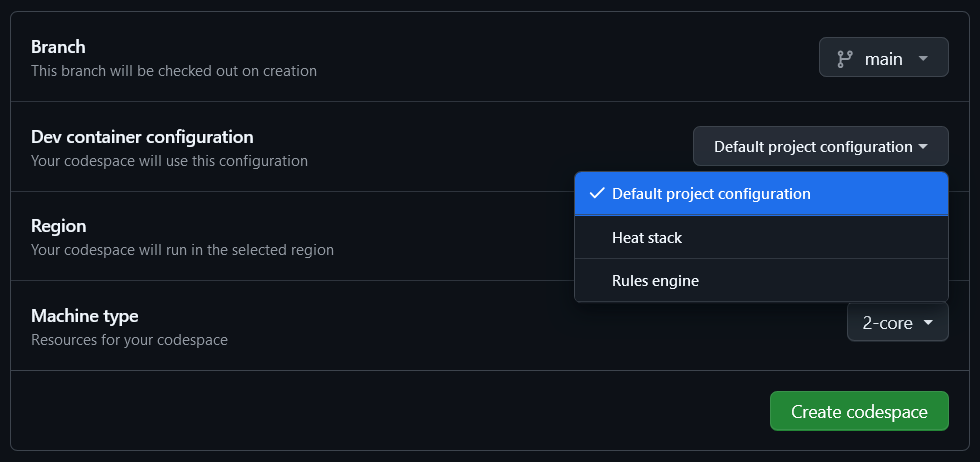

# Rules Engine

This is the workspace for the HEAT rules engine.

For an outline of the logic behind the rules engine and a glossary of common terms, see the [Intro to Rules Engine wiki page](https://github.com/codeforboston/home-energy-analysis-tool/wiki/Intro-to-Rules-Engine).

### Local Environment Setup

This project uses Python version 3.13.

Everyone working on this repository needs this setup, including JavaScript-only developers, because [pre-commit](../CONTRIBUTING.md#setting-up-pre-commit-in-this-repository) runs Python tools on every commit.

1. Clone or fork the git repository, if not already done.
2. Install `uv`. uv installs Python 3.13 and all Python packages for you, so you don't need to install Python separately.

   - On MacOS: `brew install uv`
   - On Windows: `winget install --id=astral-sh.uv -e`, then close and reopen your terminal so it can find `uv`.
   - If neither works: `curl -LsSf https://astral.sh/uv/install.sh | sh` then `. "$HOME/.local/bin/env"` (or open a new terminal).

3. From the `python` directory, run:

   ```bash
   cd python
   uv sync --extra dev
   ```

4. From the repository root, install the pre-commit hooks:

   ```bash
   cd ..
   uv sync
   uv run pre-commit install --hook-type pre-commit --hook-type pre-push
   ```

   It is safe to run these commands again at any time, for example after pulling changes that update `pyproject.toml`. JavaScript developers still complete steps 1 to 4 here. Running `npm run buildpy` in `heat-stack` builds the rules engine for the browser but does not install the hooks.

   Dev dependencies live under `[project.optional-dependencies].dev` in `python/pyproject.toml`, which `uv` treats as an "extra" rather than a dependency group. `uv sync` and `uv run` only install the base `dependencies` list unless the extra is requested explicitly, so `uv sync --dev` (with no `--extra`) will silently create a venv without pytest, and any later `uv run pytest` will fail with `error: Failed to spawn: pytest`.

   ### Checking the setup

   After running `uv sync` at the repository root, you should see:

   - The command finishes without an `error:` line and returns you to the prompt.
   - A `.venv` folder appears in the repository root.
   - Running `uv run pre-commit --version` prints a version of 4.4.0 or higher.

   After running `uv sync --directory python --extra dev`, a second `.venv` folder appears inside `python/`. This is expected, because the root and `python/` each keep their own environment.

   If a step fails and you're not sure whether it succeeded, check the exit code. Run `echo $?` in bash or zsh, or `echo $LASTEXITCODE` in PowerShell. A `0` means the command succeeded.

5. From the `python` directory, run `uv run pytest` and confirm the tests pass.

   Next steps: [heat-stack README](../heat-stack/README.md)

> **Windows + WSL users:** use one system per project folder. `.venv` only works on the system that created it, so running Windows `uv` or `npm` against a `.venv` made in WSL (or the reverse) breaks it. Inside WSL, `which npm` and `which uv` should show Linux paths, not paths starting with `/mnt/c`. If npm shows `/mnt/c/...`, install Node inside WSL by following the WSL steps under "Install Dependencies and Build" in [heat-stack/README.md](../heat-stack/README.md#install-dependencies-and-build).

## Development

Using a codespace for environment setup is highly recommended. Local environment setup can produce small build issues that can be hard to diagnose. If you prefer setting up locally without using a codespace, see [Appendix A](#appendix-a---local-environment-setup)

### Setup Codespace

If you are coding with another person, only one of you needs to do these steps.

1. From github, either open the main repo or a fork.
2. navigate to the green "code" dropdown
3. select the "codespaces" tab
4. select the "..." menu
5. select "new with options"
6. on the options screen, under "Dev container configuration", select "Rules engine"
7. click "Create codespace". This will open a web version of VSCode.



### Co-edit with LiveShare

If you are not coding with others and you want to use the web version of VSCode provided by the codespace, you can skip this step.

The owner of the codespace:

1. Install LiveShare extenion.
2. Open LiveShare extension.
3. Start a new session. This will copy a LiveShare link into your clipboard.
4. Open a new terminal.

### Open Editor

1. Open the link created for the LiveShare session.
2. When prompted, open in local VSCode or with Codespace on the web.

### Open Terminal

1. To create a new terminal, select the `Terminal => New` menu option.
2. To open an existing terminal, select the terminal in the terminal pane.
3. If you did not create the terminal, you will see a message to press Enter. This creates a request for the terminal owner to give you read/write access.
4. When the terminal owner gives you access, you will see an alert to press any key to focus the terminal. Press the alert.

### Modifying Code for an Issue

1. Find an issue to work on
2. Open a bash terminal
3. Create a branch from main. Best practice for naming looks like this: <feature/fix/chore>/<issue number>/<description>. Separate words in the description using a dash (-). Consider using the subject as a description. Example:

```
git checkout main
git switch -c feature/341/validate-address
```

4. Commit each time you make progress. This lets you:

- Lose less work when you roll back after a mistake (we all make them)
- Review smaller changes and allow your team to do the same during their review
- Protect new changes from misfortune, like a crash
- Track progress for yourself and your team

### Reverting commits

If you have already made a pull request, avoid reverting if at all possible. If you must revert a commit, consult with the team first.

To revert a commmit:

- `git reset <--soft/--mixed/--hard> HEAD~1` if you want to go to the previous commit.
- `git reset <--soft/--mixed/--hard> HEAD~2` If you want to revert 2 commits.
- `git reset <--soft/--mixed/--hard> HEAD~N` If you want to revert N commits.

Use `--soft` if you want the committed changes to be staged.  This flag is handy if you have unstaged changes you don't want to mix them with.
Use `--mixed` if you want the committed changes to be unstaged.  This flag is handy if you have staged changes you don't want to mix them with.
Use `--hard` if you want the committed changes gone immediately.  This flag causes irreversible data loss.

If you have already pushed your branch to GitHub, you have two choices depending on what else you have already done.

1. If you have opened a pull request, then do a force push via `git push origin <branch_name> --force-with-lease`
2. If you have not, then delete the branch on GitHub and push your local branch up again.

### Adding Python Packages

Check with a development lead before adding a Python package. Packages in the dev group are useful for syntax checking, testing, and building, but should be avoided for production `src` code. Adding packages to `rules-engine.whl`, which the front end uses, is more involved. To add a package to development:

1. Add the package to the `project.optional-dependencies` section of `python/pyproject.toml`.
2. In `python/`, run `uv sync --extra dev` to lock dependencies and update your environment.

We use [pre-commit](https://pre-commit.com/) to run checks automatically. For the full setup, see the [pre-commit setup guide](../CONTRIBUTING.md#setting-up-pre-commit-in-this-repository). The hooks are installed once per clone in step 4 of the [setup steps](../CONTRIBUTING.md#steps).

- **On every `git commit`:** black and isort (Python formatting), mypy (Python type checking), and prettier (formatting for `heat-stack` files).
- **On every `git push`:** pytest (the Python tests).

To run all the checks by hand without committing, run this from the repository root:

```bash
uv run pre-commit run --all-files
```

If a check fails, the commit or push is stopped and the output says which check failed. Formatters like black and isort often fix the files themselves ("files were modified by this hook"). Review the changes, `git add` the fixed files, and commit again.

If you prefer setting up locally without using a codespace, follow the steps in Local Environment Setup above.

### Creating a Pull Request

1. Rebase from main if not done recently.

<details open>
<summary>Protect your progress</summary>
Rebasing can have unexpected effects. We recommend you either push your code before rebasing or do a dry run:

```git
git checkout <rebase test branch name>
git checkout main
git pull origin main
git checkout <rebase test branch name>
git rebase main
```

If you have trouble, talk to the team. If not continue to the usual instructions.
</details>

```
git checkout main
git pull origin main
git checkout <your branch>
git rebase main
```

2. Push your branch either to a fork of the repository or to the main repo (if you have privileges): `git push origin <branch_name>`.
3. Create a pull request from github.
   - Include statement "Closes `#<issue number>`" if your changes completely fix or address the issue.
   - Check that all checks pass in the pull request.
4. Review file changes.
5. Include a brief description of the changes you made to each file.
6. Request reviewers.
